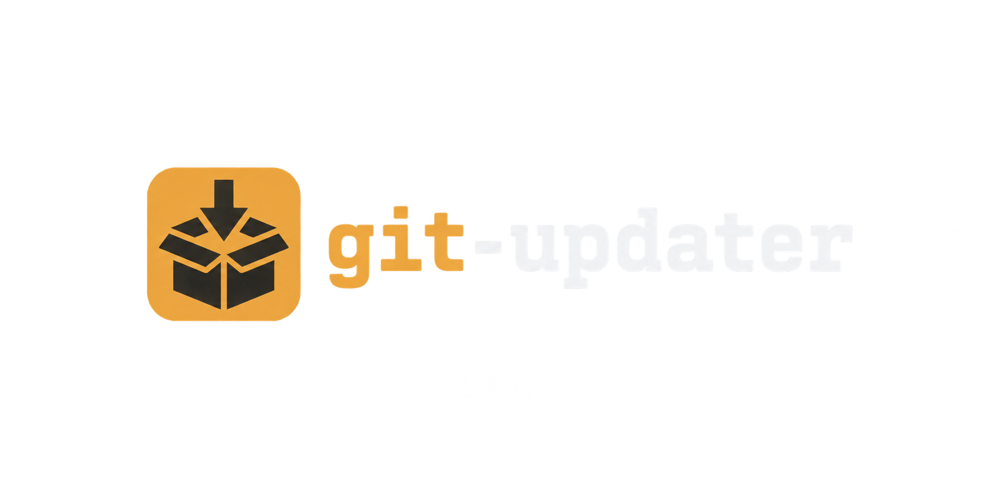

<p align="center">
  
</p>

**Install and update your apps straight from their own sources. Windows, macOS and Linux.**

A ton of great software ships on GitHub, on a vendor's own download page, or through a
package listing — and nothing keeps all of it updated. git-updater is a self-hosted
**Ninite replacement**: you pick the apps, it checks their latest releases and updates
them, portable apps and installed programs alike. No accounts, no store, nothing running
unless you ask — just your list, and for every app a plain statement of **where its file
comes from**.

## Get it

Grab the build for your machine from **[Releases](https://github.com/TeeJS/git-updater/releases)**.

| | Download | Run it |
|---|---|---|
| **Windows** | `git-updater-<v>-<arch>.zip` (x64, arm64) | unzip anywhere, run `git-updater.exe` |
| **macOS** | `git-updater-<v>-mac-arm64.dmg` (Apple Silicon) | open it, drag to Applications |
| **Linux** | `git-updater-<v>-linux-<arch>.tar.gz` (x64, arm64) | extract anywhere, run `git-updater` |

No setup and no admin rights, and closing the window exits everything — unless you turn on
the optional background mode in Settings (start at login, keep running in the tray).
Windows builds are Authenticode-signed (Thomas Schmitz, via Azure Trusted Signing); macOS
builds are Developer ID signed and notarized.

**On macOS, only notarized apps will run** — see [below](#on-macos).

An AppImage is published too. It needs `libfuse2`, which recent Ubuntu releases no longer
install by default, so on many current systems it will not start unless that is present.
The tarball has no such requirement, which is why it is the recommended Linux download.

## What it does

- **One box: a name, a GitHub URL, or any https address.** Press **Add an app** (next to
  *Check all*) and type `vlc`, paste a GitHub or GitLab/Codeberg project, or paste a
  vendor's download folder (`download.blender.org/release/`). The *Add an app* window lists
  the sources it found and, for each, the exact file this computer would get, the host it
  downloads from and whether it can be verified. You pick one; the window closes and the
  new row is checked. The Add row under the list works too, and opens the same window
  whenever there is a choice to make, so results never land somewhere you might not look.
  It figures out the right download by itself — platform, architecture, archive vs
  installer, even matching the format an app is already installed in (MSI vs EXE on
  Windows, deb vs rpm on Linux) so you never end up with duplicates.
- **Five kinds of source, always shown.** GitHub releases; GitLab and Gitea/Codeberg
  releases; **WinGet** listings on Windows and **Homebrew** listings on macOS (read as
  listings — git-updater fetches the vendor's own file and never runs `winget` or `brew`);
  and plain vendor download folders. Every row carries a source badge and the download
  host, the preview shows the full address, and the log records the host that actually
  served the file when a mirror was involved.
- **Popular apps and packs** (top right, next to *Settings*). A categorized checklist of
  well-known apps, each mapped to its real identity (the names people type, not package
  ids). Tick several, review where every file comes from, add them in one go. A *pack* is
  a named set of apps: a few are built in, you can save the apps on this computer as one,
  and export it as a file to set up another machine — a pack stores which apps, never
  which files, so the same pack works on Windows, macOS and Linux.
- **Your preferences decide.** Set a preferred source order (GitHub first, or WinGet
  first…) and a preferred type (portable or installer); when an app is available that way
  it is added without asking — no window, no choice — and the row still says where it came
  from.
- **Shows what you actually have.** *Current* comes from the system itself — the uninstall
  registry on Windows, the app bundle's own version on macOS, dpkg/rpm/flatpak/snap on
  Linux, or the portable folder — not from what some tool remembers doing. Next to it: the
  latest available version and a live status.
- **Updates on your terms.** Per-app Check/Update buttons, or *Check all* / *Update all*
  batches with live progress (Downloading 42% → Verifying → Installing). Each row has an
  overflow menu: Edit, Force reinstall, Close app & update, View source, Preview selected
  file, Open folder, Stop tracking.
- **Scan this PC** (Windows and macOS; top right, next to *Packs*). Lists the programs you
  already have that git-updater recognizes — a curated catalog of 120+ GitHub-released
  apps (browsers, media, dev tools, AI tools, runtimes), filtered to the ones that exist
  on your platform — and adds the ones you pick. Not offered on Linux, where your package
  manager already owns most of what it would find and accepting a suggestion would give
  you a second copy outside it. To add known apps you do not have yet, on any platform,
  use *Popular apps*.
- **Safe by default.** Anything that is not GitHub is fetched over HTTPS only, on every
  hop. A checksum is verified whenever one exists — pinned by a WinGet or Homebrew
  listing, or published beside the file — and a mismatch always stops the install. When a
  vendor publishes none the app says so, on the row and in the log; a Settings switch,
  *Only install files that have a checksum*, refuses those files outright. Portable
  updates are transactional — a failed or interrupted update restores the previous version completely,
  and your settings inside the app folder survive. Installers that need admin rights fall
  back to their own window with a normal UAC prompt.
- **Quiet by default.** Out of the box nothing runs at startup, nothing phones home, and
  closing the window quits — on macOS too, where it does not linger in the dock. If you would
  rather it stayed available, Settings has two switches, both off until you turn them on:
  *start at login*, and *keep running in the tray* (closing the window hides it to an icon
  instead of quitting; right-click the icon for Open, Check now and Quit). It can also check for
  updates on a schedule you write cron-style, such as `47 2 * * 2#1` for the first Tuesday of
  each month at 2:47 AM, and tell you with a notification. It never installs anything on its
  own unless you turn on the separate **Install** schedule, and even then it only touches apps
  you ticked in the **Auto-update** column that are already installed. It never force-closes
  a running app and never opens an installer window or permission prompt: an installer that
  needs your permission is skipped and reported as "needs you". It even tells you when
  git-updater itself has a new release. Settings has two more switches for that, both off:
  *check for git-updater updates when it opens*, and *auto-update git-updater* (updated by the
  Install schedule like a ticked app, then it restarts, quietly if the window is hidden).

## On macOS

**Only notarized apps will run.** git-updater will install any app you point it at, but
on Apple Silicon macOS refuses to LAUNCH anything that is not notarized — including an app
signed with a valid Developer ID that was simply never notarized, which it treats exactly
as it treats an unsigned one. git-updater cannot change that, and does not try to.

**Downloads keep their quarantine flag.** macOS attaches it, Apple's own copy tool carries
it across unchanged, and git-updater does not strip it. One consequence worth knowing: an
app you had previously approved by hand is replaced whole by an update, and the new copy
arrives carrying the download's own quarantine — so your earlier approval does not carry
over with it.

**An update that would damage an app is rolled back.** A macOS application is sealed, and
a single stray file inside it stops macOS accepting it. If an update leaves a bundle whose
signature no longer verifies, git-updater puts the previous version back rather than
leaving you with the damaged one.

**git-updater updates itself in place on Windows and Linux**, where the new version is
installed in its own folder and the launcher switches to it on next start. On macOS it
tells you a new version exists and sends you to the release page instead: an app bundle is
the unit macOS launches, so there is nowhere to put a launcher that is not itself inside
the thing being replaced.

## Quick start

1. Open Settings (top right) and pick your **portable apps folder** (`C:\PortableApps`,
   `~/Applications`, `~/Apps` — wherever you like).
2. **Add an app** (next to *Check all*) → type an app's name or paste its address → **Find**
   → in the list, press *Add as Portable* or *Add as Installer* on the source you want.
   To add several at once, use **Popular apps** (top right) instead.
3. **Check all**, then **Update all**. That's it.

Prefer beta builds for a specific app? Tick *include beta (pre-release) versions* when
adding it.

## For developers

```bash
npm install && npm start   # run from source
npm test                   # engine tests
npm run dist               # build the portable zips (signed when the machine has the signing setup)
```

`npm run dist:mac` and `npm run dist:linux` build the other two (each must run on that OS).

There's also a headless CLI (`node bin/watch.js check|update`) for scripting. Config lives in
git-updater's own folder — `%APPDATA%\git-updater\` on Windows, `~/Library/Application
Support/git-updater/` on macOS, `~/.config/git-updater/` on Linux. Per-app overrides (asset
patterns, custom install dirs, installer switches), architecture notes, and design details
are in **[docs/INTERNALS.md](docs/INTERNALS.md)**.

## License

MIT. See [LICENSE](LICENSE).
